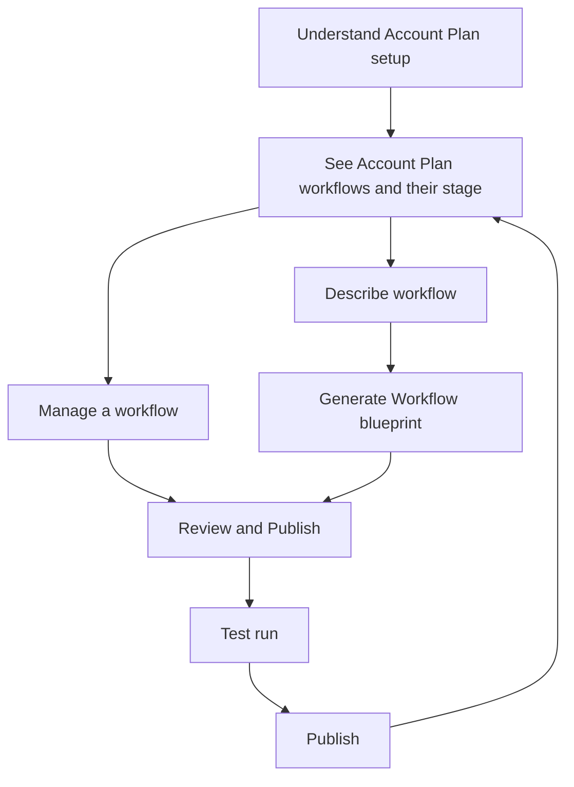

# Agentic Account Plan Setup — Design Requirements

**Status:** v0.54 — Version 3 implemented in prototype  
**Persona:** Salesforce Admin  
**Altitude:** Problem, design principles, and information architecture. Field lists are included only where a decision needed them. This document does not specify controls, copy, or visual layout.  
**Last updated:** 27 October 2026  
**Current prototype:** Version 3 (live under `prototype/`). Version 0 and Version 1 are frozen under `prototype/versions/`. Version switching is only on Workflow Setup landing; Workflow Agents and Workflow Templates use the shared V0 UI.

This is a living document. Later inputs should be added as new sections or as resolutions in [Open inputs](#open-inputs). Do not rewrite settled decisions to fit a new screen.

## How to extend this document

| Kind of input | Where it goes |
| --- | --- |
| A decision about who does what, or what the workflow tree is | [Decisions](#decisions) |
| A new Admin capability that is not a control spec | [Information architecture](#information-architecture) |
| A story of Admin work | [User stories](#user-stories) |
| Something we have seen but not chosen | [Open inputs](#open-inputs) |
| A change after v0.1 | [Change log](#change-log) |

## Sources

- Setup shell: [Workflow Setup — Landing](https://www.figma.com/design/94nQmrMqznTzbFsdyCzSJF/Next-Gen-Commercial-Banking?node-id=787-2455). Generic workflow chrome. Specialized here to Account Plan.
- Setup path on the same Figma page: Describe the workflow → Generate the blueprint → [Account Plan Blueprint](https://www.figma.com/design/94nQmrMqznTzbFsdyCzSJF/Next-Gen-Commercial-Banking?node-id=854-292) → [Edit a step](https://www.figma.com/design/94nQmrMqznTzbFsdyCzSJF/Next-Gen-Commercial-Banking?node-id=925-8381) → [Edit a task](https://www.figma.com/design/94nQmrMqznTzbFsdyCzSJF/Next-Gen-Commercial-Banking?node-id=925-7758). These frames sit in a left-to-right sequence. They are not wired as a prototype.
- Runtime structure screenshots: Northwind Logistics · 2026 Relationship Plan. This is the canonical workflow tree.
- Runtime content screenshots: Acme Manufacturing — Account Plan FY 2026. One page, scrolled. Relationship Strategy and Objectives & Measures are both agent-drafted.
- Step fields: [Edit workflow step](https://www.figma.com/design/94nQmrMqznTzbFsdyCzSJF/Next-Gen-Commercial-Banking?node-id=925-8859).
- Task fields: [Edit task](https://www.figma.com/design/94nQmrMqznTzbFsdyCzSJF/Next-Gen-Commercial-Banking?node-id=925-8236).
- Agent design note: *Agentic Account Plan — Agent Design*. Five research agents and the Account Plan sections they populate. Mapped onto task agents in [Who writes which section](#who-writes-which-section).

## Problem

Relationship teams need Account Plans that are consistent, aware of industry compliance, and partly prepared by agents. An Admin cannot define that work as a reusable workflow today.

Setup exists so a Salesforce Admin can describe an Account Plan workflow, let agents draft its blueprint, adjust the steps and tasks, and publish it. Publishing makes the workflow available at runtime. It does not fill in a customer's plan.

When the workflow later runs for an account, agents draft the plan content in a fixed structure. The Account Plan owner confirms that content. The Admin does not confirm customer content.

## Persona

**Salesforce Admin** (also referred to as Technician). One persona.

The Admin needs to understand what an Account Plan workflow is, see the workflows in the org and their stage, create one from a plain-language brief or a template, watch generation, correct the blueprint, and decide when it is available.

The Admin does not start, snooze, or dismiss a recommended action. Those belong to the person running the plan. The Admin does not confirm vision statements, objectives, or other customer content.

**Account Plan owner** (a banker, often the Relationship Manager) is outside Setup. They are named here only because they confirm agent-drafted content on the plan after the workflow runs.

## Scope

**In**

- Account Plan workflow setup: understand, inventory, describe, generate, review, publish, and start from a template.
- The blueprint that setup must be able to express: ordered steps, tasks under steps, an agent or a person on each task.
- The boundary between the workflow definition and the Account Plan record.

**Out**

- A generic workflow platform for onboarding, renewals, or upsell. The Figma shell mentions those. This document does not.
- Relationship Manager runtime actions such as Start, Snooze, and Dismiss.
- The Account Plan owner's confirmation screen as a setup surface. It is described only so Setup does not absorb that job.
- Control-level design: menus, tooltips, confirmation copy, column layouts.
- Step and task field catalogs. Those are still to be supplied.

## Design principles

1. **Account Plan first.** Examples and structure describe Account Plan workflows. Generic workflow creation is the shell this product sits in.
2. **The Admin authors the workflow. Agents draft the blueprint.** The Admin supplies intent: industry, a process description (why it exists and how it should run), and optional context (files and links). Access to a link is checked when it is added. Agents produce the step-and-task tree. The Admin decides what gets published. Sources used when the workflow runs, the refresh recommendation, and use of a prior plan period belong to the Relationship Manager at runtime.
3. **Generation is visible.** While the blueprint is being produced, the Admin can see progress, which context was used, which sources were permitted or withheld, and which agent failed. The Admin can stop generation. No Account Plan records are written or published during setup generation.
4. **The blueprint is the runtime tree.** The steps and tasks an Admin reviews are the steps and tasks that later run for an account. The canonical tree is the four-step refresh workflow in [Blueprint](#blueprint), not the Figma example of Initiate, Build, Approve, and Execute.
5. **Agents belong to tasks.** A step can contain several tasks, and those tasks can be done by different agents or a person role. Setup assigns the performer on the task. Every step has at least one task, including person-owned review.
6. **Roles, not named people.** Setup assigns roles: an agent, the Relationship Manager, a Treasury Specialist, a Credit Specialist, an Industry Specialist. Named people are resolved when the workflow runs.
7. **Industry selects compliance.** The Admin chooses an industry. The compliance context for that industry is applied automatically. There is no separate compliance choice.
8. **Publishing is a separate act.** A drafted or generated workflow is not available to bankers until the Admin publishes it. Archiving it removes it from runtime. Archived workflows stay until the Admin restores or deletes them. They are not removed after 30 days.
9. **Manage the definition.** From the inventory, the workflow name opens the definition. Actions are continue setup or edit, then archive, restore, or delete. A live workflow that is available must be deactivated before it can be archived or deleted. Deleting a workflow requires typing its name and cannot be undone. Only an Admin edits a workflow in Setup. The Relationship Manager runs it. The Admin does not share editing with other roles in this version.
10. **Customer content is confirmed by the plan owner.** Agents may draft Relationship Strategy and Objectives & Measures when the workflow runs. That content stays unfinalized until the Account Plan owner confirms it. Setup does not include that confirmation.

## Information architecture

Setup create uses three wizard steps in a **full-screen shell with a left step rail**: **Describe workflow → Generate Workflow blueprint → Review & Publish.** Version 0’s separate Generate activity page and Version 1’s modal create shell are frozen. The step rail stays visible while the Admin works. Only the active panel scrolls.

Under Workflows in Setup, **Workflow Setup** holds the org’s workflow definitions. **Workflow Agents** is the org catalog of agents an Admin can inspect and customize — not Account Plan only. The same agent can be used on Account plan, KYC renewal, credit, onboarding, and other Relationship Manager runtime workflows. Agent names on the list show as tags with an icon. The Admin can turn an agent on or off on the list, add instructions, choose which source types it may read, and set what happens if it fails. Availability is not repeated in Customize. Used on shows the primary workflow plus how many others; opening it lists each workflow and how many times the agent is used there. Person roles (Relationship Manager, Treasury, Credit, Industry) are assigned on the task, not in that catalog. The Admin does not create new agents here. **Workflow Templates** is a thumbnail library of Account Plan blueprints: four starter templates, plus **Created by you** for blueprints the Admin saved. Cards show the creator as initials and a short name. A kebab on every card — starter and created — offers Modify and Delete. Using a template opens a new Ready draft on Review. Modify opens that blueprint for editing. The Admin still tests before publish. Saving a reviewed blueprint as a template adds or updates it under Created by you. **Workflow Settings** is not a page in this version: remaining org knobs live on Workflow Agents or as product rules (industry compliance, archive, publish).

1. **Understand.** Why an Account Plan workflow exists, what the Admin is about to create, and that publishing is separate from drafting.
2. **Inventory.** The Account Plan workflows in the org. Each has a stage, whether it is available at runtime, and a created or last-updated date. The inventory does not list customer accounts. Which accounts currently have a run belongs outside Setup. Landing timeline copy names the third create step **Review & Publish**.
3. **Manage.** The workflow name opens the definition. Actions are continue setup or edit, then archive, restore, or delete. A live workflow that is available (active) must be deactivated before Archive or Delete. Turning Available on or off shows a confirmation toast. Inactive (published, Available off) and other (Draft, Generating, Ready) workflows can be archived or deleted. Archived workflows can be restored or deleted. Deleting requires typing the workflow name and cannot be undone. Only an Admin can edit. The Relationship Manager runs a live workflow.
4. **Describe.** The brief: workflow name, industry, a process description (purpose and how the process should run, in one field), and optional context the generator may use. Context is files and links. When the Admin adds a link, access is checked immediately. A link without access is not added. **Build with agent** is an optional switch on this step (agent icon in the row). On: Next is **Next: Generate Workflow blueprint** and agents draft the tree. Off: Next is **Next: Create Workflow** and the Admin lands on a blank blueprint for manual authoring. Runtime sources, the refresh recommendation, and prior-plan handling are not part of this brief.
5. **Generate Workflow blueprint.** The outline is the authoring surface. With Build with agent on, stages and tasks appear progressively under a loader sized to the outline. With it off, the Admin adds steps and tasks manually. Hover on a step exposes Reorder and Add task. Every workflow step must include at least one task (including person-owned steps such as Relationship Manager review). Generation drafts the tree; the Admin still opens Edit on each task to confirm instructions before it is ready. Each step shows a progress ring and “X of Y tasks ready” (same muted wording in every state). Tasks that still need work show Needs setup; after the Admin saves instructions they show a double tick and Ready to run. Stage reorder uses a dedicated Reorder modal. Step and task editors are modals (label left / control right; Delete is a text action on the left of the footer). Task fallback, Cc, and escalations use people search; retries are attempts or time. On this step the header keeps **Save** only. The footer pairs **Test run blueprint** with **Next: Review & Publish** on a short forward path; Next stays locked until a passing test on the current blueprint. A passing test is also required before Save as template or Publish on Review. Editing the blueprint after a test requires a new test.
6. **Review & Publish.** Confirms readiness and the connected blueprint. Layout is two columns: **Blueprint** (connected Start → numbered steps with all assignees → Publish) on one side; workflow facts (name, industry, context) and **Readiness** (tick marks for blueprint ready, test run, ready to publish) on the other. Header CTAs on this step are Save (leftmost among actions), Save as template, and Publish. Save as template opens a confirm modal with the template name prefilled. Publish shows a loader on the Publish button, then returns the Admin to Workflow Setup landing. A passing test run is still required. The test does not publish and does not write a live customer plan.
7. **Publish.** Publishing makes the workflow available as an Account Plan action. Saving a draft does not. Disabling or retiring takes it out of runtime without deleting the definition.
8. **Templates.** A starter library of Account Plan blueprints with different shapes, shown as thumbnails. Starters include a full refresh, a first relationship plan, a mid-year update, a credit-intensive plan, a Treasury and cash-management plan, an at-risk plan, a healthcare plan, and a technology growth plan. They are not industry skins of one tree. The Admin picks a thumbnail to open a new draft. Industry still selects compliance. Using a template does not publish and does not skip the test run. Save as template on Review & Publish adds an org template under Created by you. This is not a generic workflow catalog.

### Lifecycle

Stages of a workflow definition, not badges:

| Stage | Meaning |
| --- | --- |
| Draft | Brief started or blueprint saved, not published |
| Generating | Agents are producing the blueprint |
| Generation failed | One or more agents failed; successful work remains visible; the Admin can retry |
| Ready | Blueprint exists and has not been published |
| Live | Published and available at runtime |
| Archived | Removed from runtime. Stays in Archived until restored or deleted. |

Retiring a workflow archives it. A live workflow that is available must be deactivated first. Archived workflows stay until the Admin restores or permanently deletes them. They are not deleted after 30 days. Deleting a workflow requires typing its name. This cannot be undone.

## Blueprint

Setup must be able to define the following tree. The reference screenshots show it running for one account (Northwind Logistics · 2026 Relationship Plan). That running state is not the Admin editor. Later steps stay on hold until earlier work finishes. An Account Planning Agent coordinates the run.

| Step | Tasks | Who does the task |
| --- | --- | --- |
| 1. Gather Inputs | 1.1 Review client history | History Agent |
| | 1.2 Pull financial data | Financials Agent |
| | 1.3 Research market context | Market Research Agent |
| 2. Create Plan | 2.1 Draft relationship strategy | Strategy Agent |
| | 2.2 Define Objectives & Measures | Objectives Agent |
| 3. Reach out to Treasury Specialist, Credit Specialist and Industry Specialist | 3.1 Gather input from the specialists | Outreach Agent. Specialist roles are Treasury, Credit, and Industry. Named people are resolved at runtime for the account — not in Admin Setup. |
| | 3.2 Synthesize specialist feedback and update the account plan | Synthesis Agent |
| 4. Route account plan for Relationship Manager review | 4.1 Review account plan | Relationship Manager |

Tasks 1.1 through 1.3 start together when Gather Inputs starts. This tree matches the runtime cases / Start workflow outline. Every step, including person-owned review, must carry at least one task so the blueprint can be tested and published.

### Trigger

The trigger is a runtime recommendation for the Relationship Manager, not an Admin setup field.

For this Account Plan workflow the trigger is **plans approaching expiry**. When a published workflow is live, Account Plans nearing the end of their period become a recommended refresh. The Relationship Manager chooses when to start a run. The recommendation does not start the workflow and does not write the plan.

### Who writes which section

Task agents run the workflow. The five research agents write sections of the Account Plan. A task agent may call a research agent. Only one writer owns each section. Gather tasks that prepare evidence do not rewrite a section another task owns.

| Section on the plan | Writer | Called from |
| --- | --- | --- |
| Client history evidence | History Agent, read only | 1.1 |
| Performance indicators | Financials Agent, as part of Client Intelligence | 1.2 |
| Vision, strategic priorities, challenges, industry trends | Client Intelligence Agent | 1.3 Market Research Agent |
| Competitive strengths, weaknesses, competitors | Competitive Intelligence Agent | 1.3 Market Research Agent |
| Relationship summary, strengths, weaknesses, threats, opportunities | Relationship Health Agent | 2.1 Strategy Agent |
| Calling strategy | Coverage Strategy Agent, the narrative | 2.1 Strategy Agent |
| Objectives and measures | Objectives Agent | 2.2 |
| Specialist updates | The specialist | 3.1 Outreach Agent requests them and does not write the section |
| Sections a specialist changed | Synthesis Agent, those sections only | 3.2 |

The Account Planning Agent coordinates the run and does not write a section.

Sources follow the same split at runtime. History uses Salesforce activities, contacts, the account team, and opportunity history. Financials uses financial accounts and core-banking figures. Market research uses linked external sources for industry and competitors. Strategy reads finished gather outputs and writes relationship health and calling strategy. The Relationship Manager selects runtime sources when they run the workflow. Setup generation uses the Admin’s process description and any context files or links that passed access.

Each drafted section records the writer, when that writer last refreshed it, and a confidence of high, medium, or low. The plan does not use one refresh time or one confidence for every agent.

### What the Admin edits on a step

From the step editor:

- Name, required.
- Start rule: when the workflow starts, when the previous stage completes, or a custom rule. Dependencies follow from that rule.
- Description.
- The tasks in the step, in order. The step shows each task’s type, start, and due. The Admin can reorder tasks here. Owners and instructions are edited on the task.

### What the Admin edits on a task

From the task editor:

- Name, required.
- Start, and any dependency on another task.
- Due or SLA.
- Assigned agent, required.
- Accountable person.
- Fallback assignee, used after the assigned agent’s retry is exhausted.
- People to copy, and escalations.
- Instructions.
- Documents and sources.
- Tags.

The Admin tests the whole blueprint from Review, not a single task. The Admin can delete a task. The task editor does not ask for an Account Plan objective.

The Figma blueprint example (Initiate, Build, Approve, Execute, with owners such as account owner, account team, and sales manager) is an earlier illustration. It is not the Account Plan shape.

### What a step and a task can express

Conceptually, not as a form:

- A **step** has an order, a purpose, tasks, and may depend on earlier steps. A person-owned step (for example Relationship Manager review) still has at least one task assigned to that role.
- A **task** has an order inside its step, an instruction, and exactly one performing agent when an agent does the work. Tasks in the same step may use different agents.
- A task may depend on other tasks. A step's tasks are removed with the step.
- An approval, when the workflow uses one, is owned by a person.

### What setup does not write

Setup stores the recipe: the tree, the agents, the roles, and the context the generator may use.

The Account Plan record is the content for one customer. When the published workflow runs, agents draft that content. On the plan page, Relationship Strategy and Objectives & Measures are one surface. Both are agent-populated. Provenance is visible: drafted by an agent, updated by a specialist, or inherited from a prior plan. Each block stays unfinalized until the Account Plan owner confirms it. The owner may also edit or remove it.

Content groups on that page (Client Intelligence, Competitive Intelligence, Relationship Health, Risk Intelligence, Coverage Strategy, Objectives) describe readiness of the plan. They are not a second workflow tree. The workflow tree remains the four steps above.

## User stories

Persona for every story: Salesforce Admin.

1. **See Account Plan setup and start a draft.** The Admin can tell what an Account Plan workflow is for, see the ones already in the org, open a workflow from its name to continue setup or edit it, and start one. Nothing is available to bankers until it is published.
2. **Describe the Account Plan in plain language.** The Admin states the workflow name, industry, and a process description (why it exists and how it should run). Compliance for the selected industry is applied automatically. The Admin may add context as files or links. A link is checked for access when it is added. The Admin chooses Build with agent on or off before continuing.
3. **Author or watch the blueprint.** With Build with agent on, the Admin sees the outline fill progressively. With it off, the Admin creates steps and tasks manually. Generation does not write Account Plan records. Every step must have at least one task before test or publish.
4. **Review & Publish.** The Admin sees a connected blueprint of the four steps and their assignees, plus readiness (blueprint ready, test run, ready to publish). Facts show workflow name, industry, and context. Stages are reordered from a dedicated Reorder modal. Tasks are reordered or removed in the step editor. A draft can be saved. The Admin must test-run the blueprint before Save as template or Publish.
5. **Edit a step.** The Admin can change what the step is for, what it depends on, and how it is considered done. Tasks belong to the step.
6. **Edit a task.** The Admin can change the instruction, which agent or person performs it, when it starts, how long it may take, fallback, Cc, escalations, retries, and which sources it may use. Two tasks in one step may name different agents. A task does not have to name an Account Plan objective.
7. **Publish only after a passing test run.** Saving a draft and publishing are different. Publish shows progress on the Publish control, then returns to Workflow Setup. Save as template asks the Admin to confirm a template name. The Admin is not asked to confirm a customer's strategy or objectives.
8. **Start from a template.** The Admin can pick a starter Account Plan blueprint, or one saved from Review & Publish, and open it as a new draft. Using a template does not publish. A passing test run is still required.

## Decisions

- Technician and Salesforce Admin are the same persona.
- Setup create is three wizard steps in a full-screen shell: Describe workflow, Generate Workflow blueprint, Review & Publish. Version 0 (multi-page) and Version 1 (modal create) are frozen snapshots. Only Workflow Setup landing exposes the version switcher.
- Build with agent on Describe chooses agent-drafted progressive blueprint versus manual blank blueprint. Next CTA copy follows that choice.
- Every workflow step must include at least one task before test or publish, including person-owned review steps.
- The canonical workflow is the four-step tree in [Blueprint](#blueprint). Agents (or a person role) are assigned per task. Gather Inputs includes the three tasks that match the runtime cases outline (history, financials, market).
- Specialist roles in this workflow are Treasury, Credit, and Industry. Names are a runtime resolution.
- Setup generation writes the blueprint only. Customer fields are drafted later, when the workflow runs, and become final only when the Account Plan owner confirms them.
- The Admin's job ends at defining and publishing the workflow. Only an Admin edits the workflow. The Relationship Manager runs it.
- The Admin selects an industry. Compliance for that industry is applied automatically.
- The trigger is plans approaching expiry. The Relationship Manager acts on it at runtime. See [Trigger](#trigger).
- Refresh timing, prior-plan handling, and runtime sources are Relationship Manager work. They are not Admin Describe fields.
- An archived workflow stays in Archived until the Admin restores or deletes it. It is not removed after 30 days. A live workflow that is available must be deactivated before archive or delete. Deleting a workflow requires typing its name and cannot be undone.
- "Objectives" in this product are the goals on the Account Plan (step 2.2 and the Objectives & Measures content). They are not the three setup phases.
- A setup task does not point at an Account Plan objective. Evidence tasks gather cited inputs. New objectives are written only by the Objectives Agent. Loading prior objectives reads them and does not create new ones. An action that later carries out a goal can point at that objective. That association belongs on the action, not on every task in the blueprint.
- The Admin authors one reusable workflow definition. Setup inventory shows the health of that definition. It does not show which customer accounts currently have it active. A later eligible-plan count at publish time may be added without naming accounts.
- A passing test run is required before Save as template or Publish. The test uses sample account Northwind Logistics · 2026 Relationship Plan. It checks that the blueprint executes and that a sample Account Plan is generated. It does not publish and does not write a live customer plan. Changing the blueprint after a test run requires a new test.
- Review & Publish shows a connected blueprint graph and a readiness checklist. Facts are workflow name, industry, and context (not test-run or availability tiles).
- Save as template confirms a template name in a modal (prefilled from the workflow name), then stores under Created by you.
- Publish shows a loader on the Publish control, then returns to Workflow Setup landing with the definition Live.
- Workflow Settings is not a Setup page in this version. Industry compliance, archive, and publish are product rules. Agent availability, instructions, sources, and failure fallback live on Workflow Agents.
- Workflow Templates shows four starter Account Plan blueprints and Created by you templates (two seeded examples), four cards to a row. Starter cards show author Salesforce; Created by you cards show the Admin who saved them (initials thumbnail and name). A kebab on starter and created cards offers Modify, Share, and Delete. Share opens a modal for Admin name and message, then a success toast (prototype). Using a template opens a new Ready draft. Modify opens that blueprint for editing. Industry still selects compliance. A passing test run is still required.

## Open inputs

The v0.1 list is closed.

The missing measure fields called out in the agent-design note (wallet-share target, product-gap targets, profitability target, cross-line referral targets) are out of this version.

Version 3 folds blueprint authoring into **Generate Workflow blueprint** and confirmation into **Review & Publish**. Checkpoint 1 (older runtime-tree fill on a separate Generate page) remains in `prototype/checkpoints/checkpoint-1-generate` for history only. These Admin-helpful surfaces are still open, not committed:

- A human-review flag during Check the draft, as in Figma activity (stale baseline, missing owner).
- Named withheld sources per context item, not only a failed access check.
- Which linked sources were permitted, withheld, or timed out, named per task.
- A skip-and-continue for a failed optional task, versus blocking the dependent step (this workflow blocks Create Plan when market research fails).
- Confidence of the drafted tree, or which parts of the process description were ignored.
- Cost or token use. Not needed for this version.
- An eligible-plan count at Publish, still without naming accounts.
- Progressive generation currently reveals stages in sequence so the Admin can follow them. Runtime gather starts 1.1–1.3 together.
- Whether an Admin can create agents. This version customizes the org catalog of RM runtime agents; it does not create new ones.
- Whether using a template should land on Describe so the Admin can rename before Review & Publish.
- Whether Modify of a starter should copy into Created by you instead of changing the starter in place.
- Whether Workflow Agents / Templates should gain their own versioned shells later (today they stay on the shared V0 UI while only Workflow Setup versions).

## Change log

| Version | Date | Change |
| --- | --- | --- |
| 0.1 | 16 October 2026 | First living draft. Account Plan setup only. Canonical tree, per-task agents, and plan-owner confirmation recorded from the working session. |
| 0.2 | 18 October 2026 | Closed the open points: step and task fields, sources, industry, sharing, archive, agent-to-section mapping, trigger, and per-section refresh and confidence. |
| 0.3 | 18 October 2026 | Confirmed that setup tasks stay independent of Account Plan objectives. |
| 0.4 | 19 October 2026 | Setup inventory shows definition metadata (publish, trigger, last run), not the customer accounts a live workflow is active on. |
| 0.5 | 19 October 2026 | Describe uses one process description field for purpose and how the process should run. |
| 0.6 | 19 October 2026 | Describe is Admin-only: industry, process description, and context (files and links, access-checked). Refresh, prior plan, and sources move to RM runtime. Setup phases stay on the left; the brief scrolls. |
| 0.7 | 19 October 2026 | Inventory row metadata is created or last updated only. |
| 0.8 | 19 October 2026 | Generate shows the canonical Account Plan tree filling in. Setup phases stay Describe, Generate, Review. |
| 0.9 | 19 October 2026 | Generate shows parallel work, waits, context in use, and a failed agent with retry. Successful work is kept. |
| 0.10 | 19 October 2026 | Generate plays tasks in order. Default run succeeds. Failure is opt-in. Facts show writes-to, industry, compliance, and context. |
| 0.11 | 19 October 2026 | Generate facts strip removed. Simulate a failure sits in the page header. |
| 0.12 | 19 October 2026 | Generate assigns an agent only when that task starts. Assigned agents show as tags. |
| 0.13 | 19 October 2026 | Generate is Admin setup: activity log then recipe. Checkpoint 1 saved. Runtime execution is not shown here. |
| 0.14 | 19 October 2026 | Generate is an assignment preview. The Workflow blueprint outline lives on Review. |
| 0.15 | 19 October 2026 | Generate is activity only. The workflow blueprint preview is Review, not a side-by-side tree. |
| 0.16 | 19 October 2026 | Generate collapses tasks and assignments into counts and unique agent tags. |
| 0.17 | 19 October 2026 | Review header is the setup phase plus stage and task counts. Step and task editors are modals. Stages and tasks can be reordered. |
| 0.18 | 19 October 2026 | Task reorder and remove live in the step editor. Test run blueprint is on the Review header. Task editor has no Test tab. |
| 0.19 | 19 October 2026 | Setup phases sit in the page header. Describe labels file upload and file-link fields, and shows added items as thumbnails. Review has a blueprint toolbar. |
| 0.20 | 19 October 2026 | Generate shows an agent-working pattern: left-side loader, named tool calls, and a slower sequential play. |
| 0.21 | 19 October 2026 | Workflow Agents is a Setup catalog of task agents. Settings and Templates stay named only. |
| 0.22 | 19 October 2026 | Review uses one page header. The workflow name is not a second title. |
| 0.23 | 19 October 2026 | Workflow Agents can be customized: available, instructions, sources the agent may read, and failure fallback. |
| 0.24 | 19 October 2026 | Review requires a passing test run before publish. Editing the blueprint after a test requires a new test. |
| 0.25 | 19 October 2026 | Workflow Settings removed. Workflow Templates is a starter library. Test run checks blueprint execution and sample Account Plan generation. |
| 0.26 | 19 October 2026 | Generate is the activity log. The left-side agent-working card is removed. |
| 0.27 | 19 October 2026 | Workflow Templates is a thumbnail library of Account Plan starter blueprints. Using a template opens Review. Save as template adds an org template. |
| 0.28 | 19 October 2026 | Publish after a passing test shows a loader, then a success toast. The workflow becomes Live. No customer Account Plan is written. |
| 0.29 | 19 October 2026 | Workflow Templates starters are distinct Account Plan shapes (refresh, first plan, mid-year, credit, Treasury, at-risk, healthcare, technology growth), not industry skins of one tree. |
| 0.30 | 19 October 2026 | Inventory actions are the same set per row, with Archive and Delete disabled while a live workflow is available. Deleting requires typing the workflow name. Archived workflows are not purged after 30 days. |
| 0.31 | 19 October 2026 | Inventory actions do not include Duplicate. |
| 0.32 | 19 October 2026 | Workflow Agents is the org catalog across RM runtime workflows, not Account Plan only. Used on shows the primary workflow plus others, with a usage modal and instance count. Availability is only on the list. The list is A–Z. |
| 0.33 | 19 October 2026 | Workflow Templates: Created by you (was Your templates), four starters, four cards per row, creator initials and name, kebab Modify/Delete on starter and created cards. |
| 0.34 | 19 October 2026 | Turning a live workflow available or unavailable shows an auto-dismissing confirmation toast. |
| 0.35 | 19 October 2026 | Agent usage modal subtitle matches the list: workflows and how many times. Close is not focused on open. |
| 0.36 | 19 October 2026 | Inventory workflow name opens the definition. Actions use Edit instead of Open. |
| 0.37 | 19 October 2026 | Agent names on the Workflow Agents list show as tags with icon. |
| 0.38 | 19 October 2026 | Describe does not show a default Example workflow attachment; attached-file UI only when a file is attached. |
| 0.39 | 19 October 2026 | Workflow Templates kebab adds Share (Admin name + message modal, success toast); Created by you seeds two templates. |
| 0.40 | 19 October 2026 | Generate blueprint uses constrained width like Describe; reduced boxes/lines for a cleaner setup surface. |
| 0.41 | 19 October 2026 | Review: stage reorder via dedicated modal (no per-step arrows); Save as template gated like Publish until test run; header CTAs are Test run, Save as template, Publish. |
| 0.42 | 19 October 2026 | Workflow Templates cards are denser; kebab is a quiet icon without a container; creators use real admin names with matching initials. |
| 0.43 | 19 October 2026 | Starter templates show author Salesforce; more space between creator and Use this template on template cards. |
| 0.44 | 19 October 2026 | Prototype UI version control: header dropdown on the right shows V0; frozen snapshot under prototype/versions/v0. |
| 0.45 | 19 October 2026 | Version control moved to Setup bar (with Home / Object Manager); label is Version 0; quieter text-style control. |
| 0.46 | 19 October 2026 | Version 1: Available in Actions menu; New workflow is a modal with vertical Describe → Blueprint steps (Generate skipped, progressive AI reveal); + Task / + Workflow insert under each stage. Version 0 frozen. |
| 0.47 | 19 October 2026 | Version 1 Describe: optional Build with agent switch (USP on time saved); off opens a blank blueprint with manual step/task editors. |
| 0.48 | 21 October 2026 | Version 3 (live): full-screen create with left step rail — Describe workflow → Generate Workflow blueprint → Review & Publish. V0/V1 frozen. Version switcher only on Workflow Setup landing; Agents/Templates stay shared V0 UI. |
| 0.49 | 21 October 2026 | V3 Describe: Build with agent row with Einstein icon; Next is Generate Workflow blueprint or Create Workflow. Blueprint step: progressive gen loader, Notion-style hover Reorder/Add task, every step requires ≥1 task, people search for fallback/Cc/escalations, retry attempts or time. Test run stays on blueprint step and gates template/publish. |
| 0.50 | 21 October 2026 | V3 Review & Publish: two-column layout (connected blueprint chain + facts/readiness ticks); facts are name, industry, context; Save as template confirm modal with prefilled name; Publish loader on CTA then return to Workflow Setup landing. Prototype published at Account-plan-Setup GitHub Pages. |
| 0.51 | 27 October 2026 | Canonical blueprint content aligned to runtime cases / Start workflow: Gather Inputs 1.1–1.3 only; specialist step title and named specialists; synthesize + update plan; Route account plan (no “the”). Loader and Agents catalog copy updated. |
| 0.52 | 27 October 2026 | Admin Setup blueprints stay role-level only — no account/RM-specific named people (e.g. Priya Kapoor) in generated or template tasks; names resolve at runtime. |
| 0.53 | 27 October 2026 | Blueprint outline: step progress ring + muted “X of Y tasks ready”; tasks show Needs setup until Admin saves instructions, then double tick + Ready to run. No paraphrasing task subtext on the step or task. |
| 0.54 | 27 October 2026 | Blueprint step: header Save only; footer places Test run beside Next with a forward path; Next (and Review navigation) unlock only after a successful test. |
